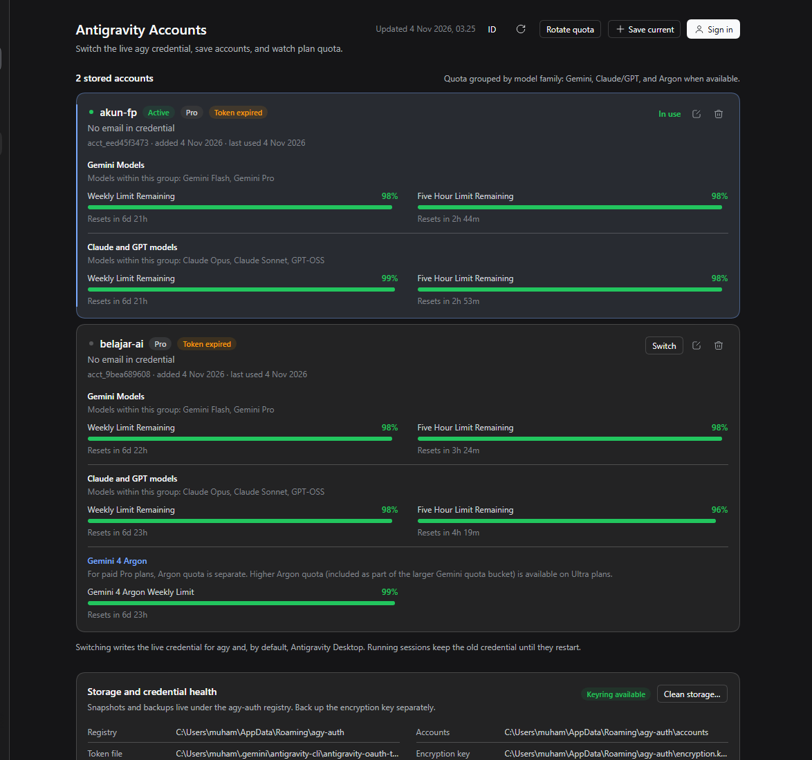
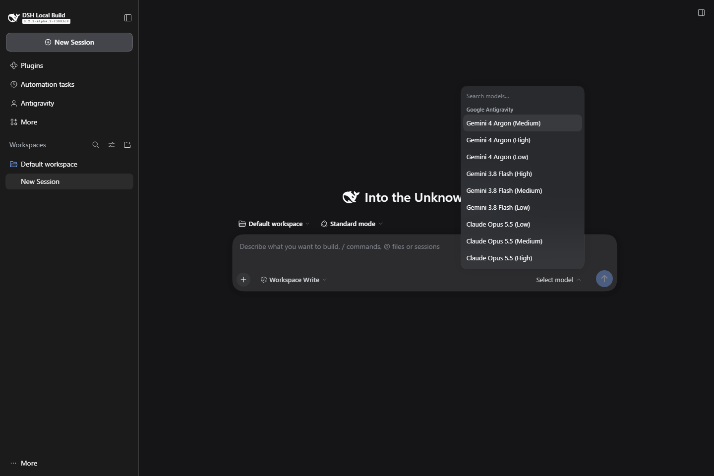
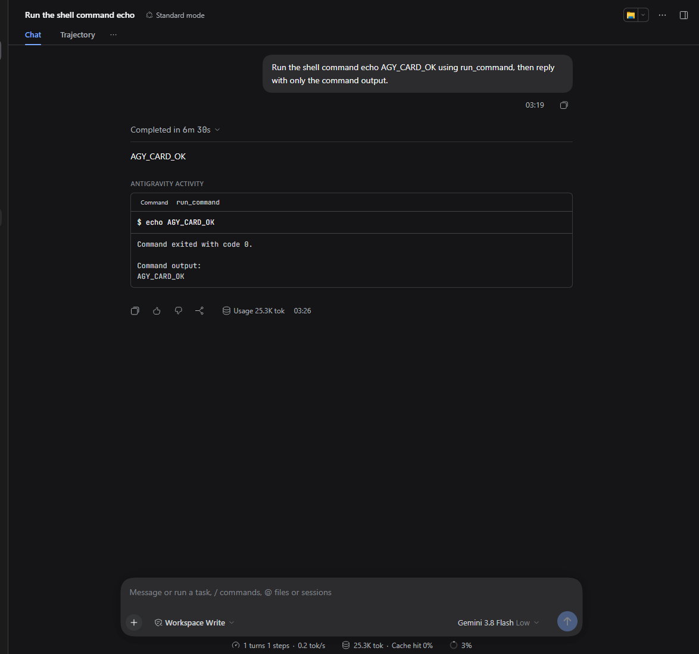

# DeepSeek Harness plugin

[agy-auth](../README.md) ships as an installable [DeepSeek Harness](https://github.com/deepseek-ai/deepseek-harness) bundle. It adds an **Antigravity Accounts** page to the Harness Web GUI and a set of `agy_auth_*` tools for the agent, all backed by the same Go CLI.



## Why a wrapper

The CLI already owns the security-critical path: the OS keyring, the file mirror, encrypted snapshots, AES-GCM backups, OAuth, and quota. The plugin therefore does not reimplement any of it. The Host half spawns `agy-auth --json`, validates the versioned envelope, caches reads, and keeps one interactive login process alive; the browser half only renders account metadata and calls same-origin routes.

```text
┌──────────────────────── DeepSeek Harness Host ────────────────────────┐
│  ctx.tools  agy_auth_*  ─┐                                            │
│  /agy-auth/api routes  ──┼──▶  AgyAuthService  ──▶  agy-auth --json   │
│  ctx.webServer + trust   │        (cache, login)        (argv, no shell)│
└──────────────────────────┼────────────────────────────────────────────┘
                           │ JSON over same-origin fetch
┌──────────────────────────┴── DeepSeek Harness Web GUI ────────────────┐
│  sidebar "Antigravity" → main panel: accounts, quota, dialogs          │
│  browser store: snapshot + polling; no credential values arrive here   │
└────────────────────────────────────────────────────────────────────────┘
```

## Install

Requirements: a local Harness checkout with `dsh web`, Node.js 20+, and `agy-auth` available to the user running the Host.

From the repository root:

```shell
# 1. Build the browser bundle from this checkout.
npm --prefix dsh-plugin install
npm --prefix dsh-plugin run build

# 2. Create a Web profile that includes the base and web-app bundles.
dsh --profile antigravity --from-default-profile web --dump-config

# 3. Install the package as a profile bundle, then boot.
dsh plugin --profile antigravity add ./dsh-plugin
dsh --profile antigravity
```

Open the **Antigravity** entry in the left sidebar. The plugin row id is `agy-auth`.

The package also installs from git (`npm install` runs its `prepare` build) or from a packed tarball; see [the package README](../dsh-plugin/README.md).

### Hot-load into a running Web profile (local checkout)

The Web profile's `cordis.patch.yml` is watched by HMR, so a local checkout can load both halves without restarting `dsh web`. Install nothing as a bundle and add one profile row:

```yaml
- insert:
    - id: agy-auth
      name: '/absolute/path/to/dsh-plugin/src/index.js'
      config:
        binary: '/absolute/path/to/agy-auth'
        agyPath: '/absolute/path/to/agy'
```

The Host row and browser entry become live; refresh the Harness page if the **Antigravity** sidebar entry is not visible yet. Keep this row as the only activation — adding the same package as a bundle too registers a second instance. The row also applies at the next boot, so the checkout path must stay valid.

This path registers no bundle, so the plugin has **no card and no on/off switch in the Plugins menu**; only a `disabled: true` override or the plugin manager's `set_plugin` operation turns it off. When you want the card, its switch, and its row list, install the checkout as a bundle instead — `dsh plugin --profile <profile> add link:/absolute/path/to/dsh-plugin` — and keep the row's settings as an id-targeted override (`- id: agy-auth` with `config:`) supplied by the profile patch.

## What the page does

| Area | Behavior |
|---|---|
| Account list | Active first (CLI order), alias/email, plan, token state, 5-hour and weekly remaining quota with reset countdowns. |
| Switch | Writes the selected snapshot to the CLI credential and, by default, the Antigravity Desktop profile. |
| Save current | Stores the account `agy` is signed in to now; optional alias. A live-but-unstored credential appears as a banner. |
| Sign in | Starts `agy-auth login --no-browser`, shows the Google URL, accepts the authorization code, and refreshes the list. One session at a time; ten-minute window. |
| Alias | Set or clear a short switch query. |
| Remove | Deletes one encrypted snapshot; optional live logout. Confirmation required. |
| Rotate quota | Switches to the stored account with the healthiest 5-hour quota when the active one is exhausted. |
| Clean storage | Previews managed backups beyond retention and orphan snapshots, then removes them. |
| Storage health | Registry, accounts directory, token file, encryption key, keyring availability, mirror state, running processes, CLI version. |

Quota is a network read. The Host caches `list` for `listTtlMs` (60 s by default) and the page polls every 30 s, so an open page does not hammer Antigravity. Press Refresh to force a read.

## Antigravity model provider





The same Loader row registers the LLM provider route `antigravity` through `ctx.llm.registerAdapter`. Every model that `agy models` reports appears in the normal DSH model selector under **Google Antigravity** — in the current CLI build that includes Gemini 4 Argon, Gemini 3.8 Flash (High/Medium/Low), Claude Opus 5.5, Claude Sonnet 5.5, and GPT-OSS 120B.

Each DSH model turn starts one process:

```text
agy -p <prompt> --output-format stream-json --model <id> \
  --print-timeout <n>s --disable-slash-commands \
  --dangerously-skip-permissions [--conversation <id>]
```

The stream parser maps:

| agy stream event | DSH stream chunk |
|---|---|
| `step_update.step_type=agent_response` + `text_delta` | assistant text delta |
| `step_update.step_type=thinking/thought/reasoning` | reasoning delta |
| `step_update.step_type=tool_call` with `tool_info` | reasoning annotation `[agy tool] …` |
| `usage` on a done step and on `result` | DSH token usage before `finish` |
| `result` with `conversation_id`, status, response | finish reason and session binding |

### Permission and tool boundary

The default `model.permissionMode` is `skip`, which passes `--dangerously-skip-permissions`. `agy` then runs its own file and shell tools **without DSH approval or DSH sandboxing**. This is deliberate: the provider is an embedded agent, not a DSH tool-calling model.

- `agy` tool steps are shown as reasoning annotations. They are **not** DSH tool calls; DSH cannot approve, deny, or execute them.
- DSH tool definitions are not forwarded to `agy`. The model uses agy's native tools (`run_command`, `view_file`, `write_to_file`, …).
- Use `plan` or `accept-edits` to narrow agy's behavior. In headless mode agy may automatically deny a tool request; that denial is preserved as an error, not converted into an approval.
- The provider never receives the agy OAuth token. It uses the credential the installed CLI already owns.

### Session binding

The Host stores one `agy` conversation id per DSH session in the model state file (default under the DSH home, mode `0600`). The first turn creates a conversation and seeds it with a digest of the DSH history; later turns pass `--conversation <id>` and send only the latest request. Switching to another model starts a new conversation. A failed run with no content clears the binding so the next attempt can start cleanly.

### Model configuration

All model keys live under the row's `model:` object:

```yaml
- id: agy-auth
  config:
    agyPath: C:\Users\me\AppData\Local\agy\bin\agy.exe
    model:
      enabled: true
      defaultModel: gemini-3.8-flash
      defaultEffort: medium
      permissionMode: skip
      proxyUrl: ''
      autoRotate: false
```

| Key | Default | Meaning |
|---|---|---|
| `model.enabled` | `true` | Register the provider route. |
| `model.defaultModel` | `gemini-3.8-flash` | Fallback when a request omits the model. |
| `model.defaultEffort` | `medium` | Default Gemini effort when the caller omits one. |
| `model.hiddenModels` | `[]` | Model ids hidden from the picker. |
| `model.permissionMode` | `skip` | `skip` → `--dangerously-skip-permissions`; `plan`/`accept-edits` → `--mode`. |
| `model.timeoutMs` | `600000` | Hard run deadline and `--print-timeout`. |
| `model.idleTimeoutMs` | `300000` | Kill a run that emits no stream event for five minutes. |
| `model.maxConcurrent` | `1` | Maximum simultaneous agy model processes. |
| `model.contextChars` / `maxPromptChars` | `24000` | History digest budget; longer prompts go to a private temp file. |
| `model.contextWindow` / `maxTokens` | `1000000` / `8192` | Metadata advertised to the DSH picker. |
| `model.forwardSystemPrompt` | `false` | Prepend the DSH system prompt to the agy prompt. |
| `model.proxyUrl` | unset | Optional HTTP(S)/SOCKS proxy for agy runs; loopback is excluded. |
| `model.autoRotate` | `false` | On a quota failure, run `agy-auth rotate` for the next attempt. **Warning:** switches the live credential while other sessions may run; no retry of partial output. |
| `model.capacityFallback` | `true` | On a 503 capacity error, try the same Gemini family at the next lower effort before failing; capacity errors are not retried by the DSH retry loop. |
| `model.allowAuxiliary` | `true` | Permit session-title/compaction calls to use this provider. |
| `model.auxiliaryPermissionMode` | `plan` | Auxiliary calls use plan mode, not unattended skip. |
| `model.auxiliaryMaxChars` | `800000` | History budget for auxiliary calls. |
| `model.mediaDir` / `mediaTtlMs` | beside state / 7 days | Staged image files and retention. |
| `model.retryMaxRetries` / delays | `2` / `1000`..`8000` | Transient retry policy. |
| `model.suppressAgyAutoUpdate` | Windows: `true` | Refresh agy's update timestamp before spawn. |
| `model.goalContext` / `planContext` | `true` | Forward DSH goal objective and plan-mode state. |
| `model.stateFile` | DSH home | Conversation binding file; tool activity cards live beside it in `activity.json`. |
| `model.agyPath` / `agyArgs` / `extraArgs` | top-level `agyPath` / `[]` / `[]` | Executable and argv overrides. |

### Quota, activity, and language UI

The account page now reads `agy-auth usage --all` and renders the CLI's model-family groups: **Gemini Models**, **Claude and GPT models**, and **Gemini 4 Argon** when the account has that separate weekly pool. Each group keeps its own 5-hour and weekly bars, so the two aggregate bars no longer hide which family is exhausted. The Host caches this read for 60 seconds; **Refresh** forces a fresh query.

Tool steps are mirrored into a bounded `activity.json` and rendered under the completed chat turn as one collapsible activity trail: a 24px header with the step count and span, then one row per step in the same disclosure language as the Host's own tool rows. A row carries the tool-family glyph, the verb, and the command, path, query, or count; expanding it shows the recorded result — a terminal card for commands (exit code parsed out of agy's envelope), the full path and measure for files, and the text for memory and task results. Failed steps keep their failure in the row, and a result agy truncated shows its spilled file path. This is a plugin-rendered activity surface: agy still executes its own tools, the DSH stream still carries reasoning annotations, and these rows are **not** DSH tool-call blocks.

The browser page ships English and Indonesian copy. English is the default; the `EN/ID` header button switches language and persists the choice in the browser's `localStorage`. Host errors and some relative quota durations remain in the Host's language.

### Reliability, images, and context

- **Images:** image blocks are staged as files in `model.mediaDir`, referenced by absolute path, and authorized to agy with repeatable `--add-dir`. This is file-based vision, not a native image wire block.
- **Goal/plan:** the current DSH goal objective and plan-mode state are prepended to the agy prompt. A bound agy conversation receives the short update each turn.
- **Long tools and truncation:** the idle watchdog defaults to five minutes; the prompt tells agy to read a spilled full-output file when a tool result is truncated, and the activity row carries the `Truncated` marker plus that file path. Raise `model.idleTimeoutMs` for tools that can run silently longer; `model.timeoutMs` remains the hard cap.
- **Windows:** `model.suppressAgyAutoUpdate` refreshes `last_check.timestamp` before each spawn, so agy's visible `--bg-updater` child does not start. Manual `agy update` still works.
- **Retry:** failures are classified into `AGY_AUTH`, `AGY_CAPACITY`, `AGY_NETWORK`, `AGY_RATE_LIMIT`, `AGY_ELIGIBILITY`, `AGY_TOOL`, `AGY_TIMEOUT`, `AGY_EMPTY`, and `AGY_ERROR`. Capacity 503 downgrades within the Gemini family (high → medium → low) before failing and is not handed to the DSH retry loop. Network/timeout/empty/server failures use bounded backoff. Rate limits are not silently retried; `model.autoRotate` remains opt-in.
- **Auxiliary calls:** session-title and compaction use `plan` mode, an 800K-character digest, a private temp prompt file when needed, and never bind the main conversation.
- **Fallback catalog:** if `agy models` is signed out or fails, the picker still gets the bundled known model list instead of going empty.

### Cost and latency

One model call is one **full agy agent run**, not a raw completion. Measured on the current account with Flash Low: about 14.3k input tokens and 8.3 s for a trivial prompt; Flash High: about 14.3k input tokens and 88.8 s. The 14.3k input context is fixed agent/skill/tool context, not the user's prompt. Keep this provider for delegated or substantial work; expect each session turn to consume Antigravity quota.

### Status tool

`agy_model_status` reports provider availability, permission mode, default model/effort, idle timeout, capacity fallback, retry delays, Windows update suppression, discovered models, proxy/auto-rotate flags, and warnings. It is the quickest way to diagnose a missing model picker entry.

## Configuration

The bundle inserts one Loader row:

```yaml
- insert:
    - id: agy-auth
      name: '@aryajava/dsh-agy-auth'
```

Override it in the profile's `cordis.patch.yml` (or a `--patch` overlay). A patch replaces the row's whole `config`:

```yaml
- id: agy-auth
  config:
    binary: C:\Users\me\AppData\Roaming\npm\agy-auth.cmd
    env:
      AGY_AUTH_STORAGE: file
```

| Key | Default | Meaning |
|---|---|---|
| `binary` | `agy-auth` | Name on `PATH` or an absolute path. Windows `.cmd` shims are unwrapped to the Node script they launch. |
| `agyPath` | unset | Absolute path to `agy` when it is not on the Host's `PATH`; sign-in passes it as `--agy`. |
| `args` | `[]` | Prefix arguments; use with `binary: node` to launch a script. |
| `env` | `{}` | Extra environment for every CLI call. |
| `commandTimeoutMs` | `120000` | Deadline for ordinary commands. |
| `listTimeoutMs` | `180000` | Deadline for `list` (network quota lookups). |
| `listTtlMs` | `60000` | Host cache for `list`. |
| `statusTtlMs` | `30000` | Host cache for `status` and `path`. |
| `loginTimeoutMs` | `600000` | One sign-in's deadline. |

The plugin always adds `--json --no-color` and `AGY_AUTH_NO_UPDATE_CHECK=1`.

## Model tools

The Host registers nine tools in `ctx.tools`: `agy_auth_list`, `agy_auth_status`, `agy_auth_switch`, `agy_auth_add`, `agy_auth_alias`, `agy_auth_remove`, `agy_auth_rotate`, `agy_auth_usage`, and `agy_model_status`.

Each returns a structured JSON value and a readable text projection. Failures (unknown account, missing CLI, quota error) come back as `{ ok: false, error: { code, message, hint } }` instead of throwing, so the model can act on the hint. `agy_auth_remove` requires `confirm: true`.

Tools work even when the Web GUI is not mounted; the HTTP API mounts only when `ctx.webServer` exists.

## Security model

- No credential, refresh token, ID token, or OAuth client secret is read, logged, or returned by the plugin. The page shows email, alias, plan, quota, and timestamps only.
- The CLI runs as the Harness Host user, inheriting its OS keyring session and file permissions. Run the Host as the same user who normally runs `agy`.
- Commands are spawned with an argv array; the plugin never invokes a shell. A Windows `.cmd` shim that cannot be unwrapped produces an actionable setup error instead of a shell fallback.
- Every route runs `ctx.connection.requestRejection` (the same Host/Origin/login-token fence as other Harness routes), caps bodies at 64 KiB, and requires `application/json` for writes.
- The login URL is exposed to the page because the user must open it. The authorization code travels from the page to the CLI over the same-origin API and is written to the waiting process's stdin.
- Switching creates the CLI's own backups before replacing the live credential. Keep `~/.config/agy-auth/encryption.key` backed up separately.
- The model provider's default `skip` mode lets agy's own tools write files and run shell commands outside DSH approvals. Set `plan`/`accept-edits` or keep the default and treat the provider as an unattended agent.
- The provider logs no prompt or token content. Session binding files contain conversation ids only.

## Troubleshooting

| Symptom | Fix |
|---|---|
| "The agy-auth CLI is not available" | Install `@fikrilal/agy-auth`, or set `binary` to the executable. On Windows the npm shim is unwrapped automatically; if it is not a Node launcher, point `binary` at the packaged `.exe`. |
| Accounts are empty but agy is signed in | Use **Save current**; the CLI stores snapshots explicitly. |
| Quota shows "—" or "Quota unavailable" | The backend read failed (network, auth, or unsupported account). The list still shows stored accounts; retry Refresh. |
| Sign-in stays on "Starting" | The CLI could not discover the OAuth client from the installed `agy`; set `AGY_AUTH_CLIENT_ID`/`AGY_AUTH_CLIENT_SECRET` or install `agy`. |
| Switching did not affect a running session | Restart `agy`; running sessions keep the old credential in memory. Desktop profiles need `--relaunch` (the page uses default switching; use the CLI for relaunch). |
| Panel does not appear | Rebuild `lib/client.js` (`npm run build`) and restart the Host; the client module system serves built bundles, not sources. |
| `Could not find module ... dsh-agy-auth` at boot | The bundle was not installed into this profile; run `dsh plugin --profile <name> add ./dsh-plugin`. |
| No Google Antigravity group in the model picker | Check `agyPath`, run `agy models` as the Host user, keep `model.enabled: true`, and call `agy_model_status`. The Host must have the `llm` service. |
| Model returns an empty response or an agy error | Run `agy -p "say ok" --output-format json` manually; check quota, proxy, and whether the selected model is available to this account. |
| agy tool runs without a DSH prompt | Expected in `skip` mode; agy owns its tools. Switch `permissionMode` to `plan`/`accept-edits` if that is not acceptable. |
| High latency | Prefer Flash Medium/Low or Claude/Flash variants with lower effort; High adds thinking time. |

## Development and verification

```shell
cd dsh-plugin
npm install
npm run typecheck
npm test
npm run build
```

`test/fake-agy-auth.mjs` implements the real envelope for unit tests and manual GUI checks. The repository's Go harness (`make verify`) does not cover the plugin; run both when the CLI and plugin change together.

## Limits

- Web GUI only; the panel has no Desktop/Electron transport.
- One interactive sign-in at a time.
- The page switches with the default target (`all`) and does not expose `--relaunch`, `--close-desktop`, import, export, or update actions. Use the CLI for those.
- The model provider is single-account and uses the live agy credential; there is no account pool or automatic rotation unless `model.autoRotate` is explicitly enabled.
- Images are file-staged and authorized with `--add-dir`; this is not a native image wire block. Activity cards are plugin-rendered under the turn, not DSH tool-call blocks. DSH tool definitions are still not forwarded to agy.
- Model calls are full agy agent runs (about 14k input tokens), not cheap completion calls. The five-minute idle watchdog can be raised with `model.idleTimeoutMs`.