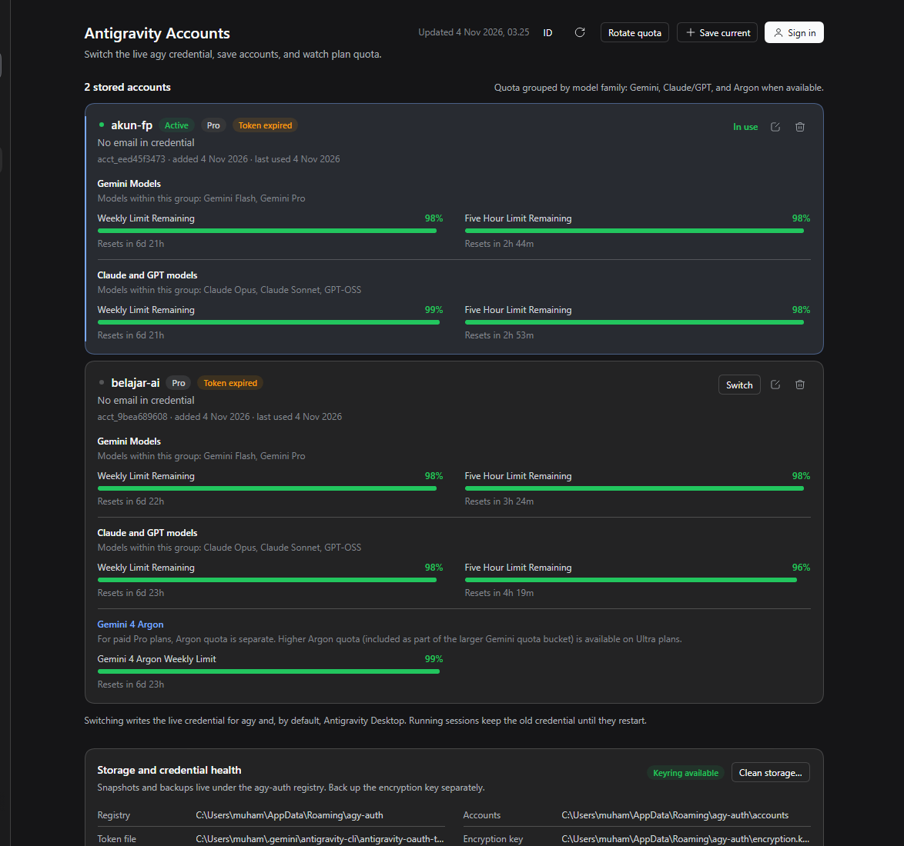
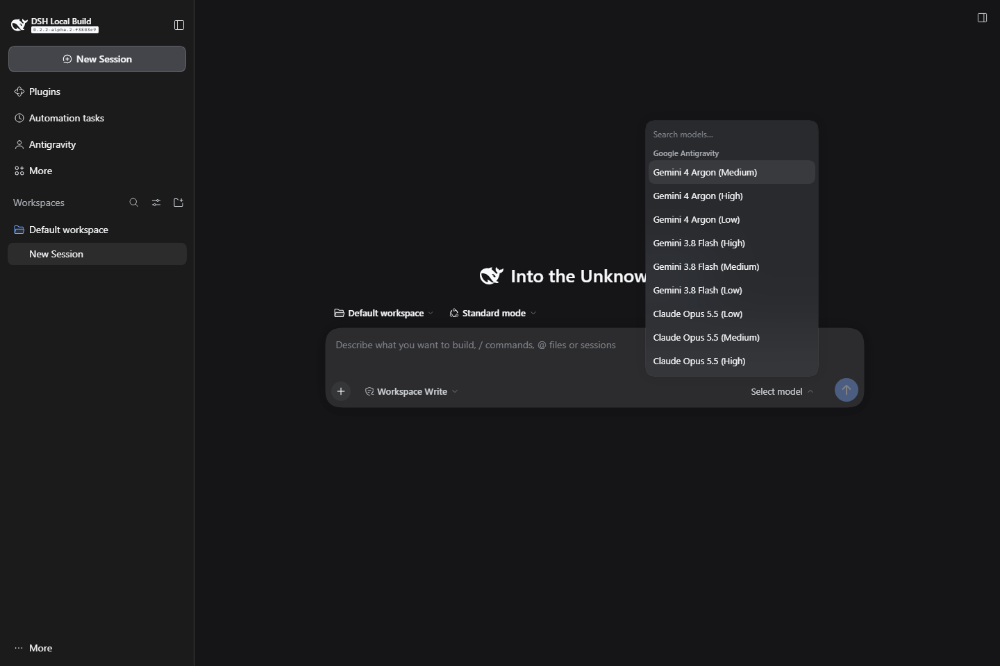
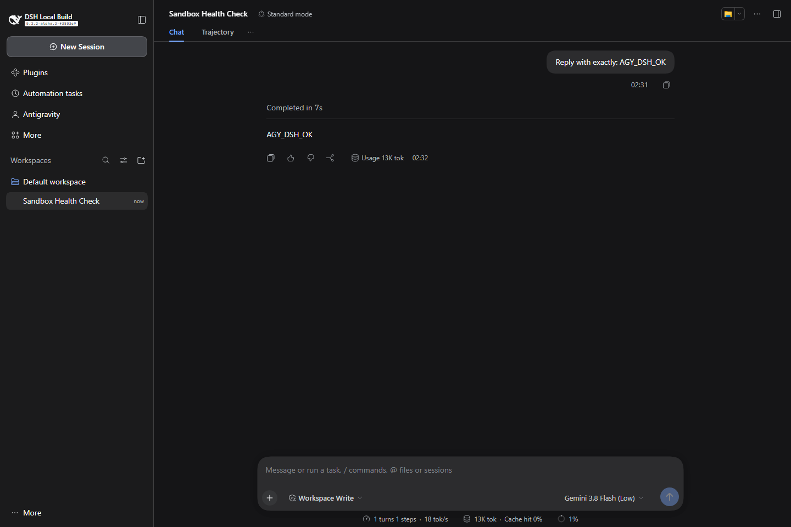
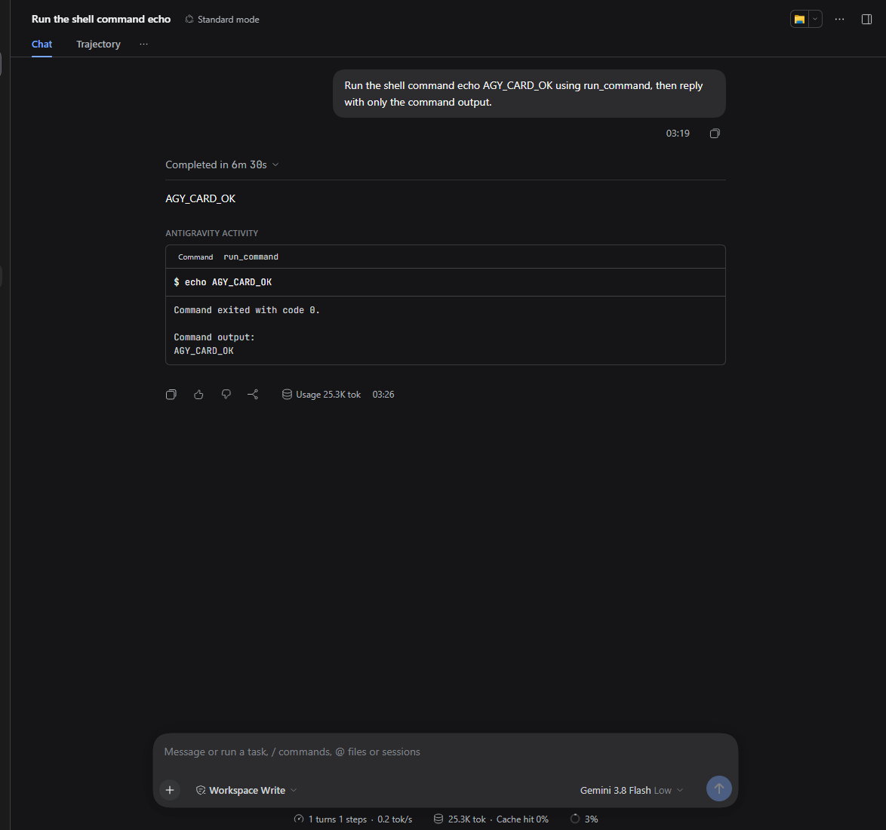

# @aryajava/dsh-agy-auth

DeepSeek Harness plugin for the [agy-auth](../README.md) CLI: an **Antigravity Accounts** page in the Web GUI, model-callable account tools, and an **Antigravity model provider** that puts Gemini, Claude, and GPT-OSS models in the Harness model selector.









## What it does

- Lists stored Google Antigravity accounts with the active account, plan, 5-hour/weekly quota, and reset times.
- Switches the live credential for `agy` and Antigravity Desktop.
- Saves the account agy is currently signed in to.
- Runs the `agy-auth login` OAuth flow from the page: start, open the Google URL, paste the authorization code.
- Sets or clears aliases, removes snapshots, rotates to a healthy account, and previews storage cleanup.
- Exposes the same operations to the model as `agy_auth_*` tools.

The Go CLI remains the only component that touches credentials, the OS keyring, or Google OAuth. This package is a node-side wrapper plus a browser page.

## Antigravity models in DSH

The same Loader row registers an LLM provider named `antigravity`. Models reported by `agy models` (Gemini 4 Argon, Gemini 3.8 Flash, Claude Opus/Sonnet 5.5, GPT-OSS 120B, and whatever the installed CLI advertises) appear in the normal DSH model selector.

Each DSH turn starts one `agy -p --output-format stream-json` process. The provider maps:

- `agent_response` text deltas to assistant text;
- `thinking`/`thought` steps to reasoning blocks;
- `tool_call` steps to reasoning annotations such as `[agy tool] run_command ...` (agy executes its own tools; these are not DSH tool calls);
- token usage to DSH usage (input/output/thinking/cache/total);
- the DSH session id to an `agy --conversation` id, persisted under the DSH home.

The provider is intentionally single-account: it uses the live `agy` credential managed by this plugin. There is no account pool and no automatic rotation by default.

### Quota, activity, and language UI

- The account page reads `agy-auth usage --all` and shows **Gemini Models**, **Claude and GPT models**, and **Gemini 4 Argon** as separate groups with their 5-hour/weekly buckets. Accounts without an Argon pool simply show the first two groups.
- agy tool steps are recorded locally and rendered as a collapsible **activity trail** under the completed turn: one header with the step count and span over one 24px row per step, expandable to the recorded command, path, or text. They are not DSH tool-call blocks; agy still executes its own tools and the stream maps them to reasoning annotations as before.
- The page ships English and Indonesian copy. **English is the default**; the `EN/ID` button in the header switches and persists the choice in `localStorage`.
- Images are staged into `model.mediaDir` and referenced by absolute path with `--add-dir`; agy reads them with its file/vision tools. DSH tools are still not forwarded.
- The provider advertises Gemini effort as a model-level reasoning selector and runs the matching exact agy slug (for example `gemini-3.8-flash-low`), which avoids the slower base-model effort path.
- Current DSH goal objective and plan-mode state are included in the agy prompt; session-title and compaction calls run in `plan` mode without touching the main conversation binding.

## Requirements

- DeepSeek Harness with the Web GUI (`dsh web`), 0.2.x.
- Node.js 20+ where the Harness Host runs.
- `agy-auth` installed for the user running the Host
  (`npm install -g @fikrilal/agy-auth`, or a standalone binary).
- Antigravity CLI (`agy`, 1.4+) installed and signed in for the same user. Set `agyPath` when `agy` is not on the Host's `PATH`.

## Install

Build the browser bundle first; the repository does not ship generated artifacts. From the repository root:

```shell
npm --prefix dsh-plugin install
npm --prefix dsh-plugin run build
```

Create a web profile (skip this if you already have one), then install the local checkout:

```shell
dsh --profile antigravity --from-default-profile web --dump-config
dsh plugin --profile antigravity add ./dsh-plugin
dsh --profile antigravity
```

The bundle inserts one Loader row with id `agy-auth`. Open the **Antigravity** entry in the left sidebar.

For a git install, the package runs its `prepare` build; pnpm may require the `allowBuilds` approval that `dsh` prints.

## Configuration

Override the row in your profile's `cordis.patch.yml` (or a `--patch` overlay). A patch replaces the whole `config` object, so restate every key you keep:

```yaml
- id: agy-auth
  config:
    binary: C:\Users\me\AppData\Roaming\npm\agy-auth.cmd
    env:
      AGY_AUTH_STORAGE: file
```

| Key | Default | Meaning |
|---|---|---|
| `binary` | `agy-auth` | Executable name on `PATH`, or an absolute path. Windows `.cmd` shims are unwrapped to their Node launcher. |
| `agyPath` | unset | Absolute path to the `agy` binary when it is not on the Host's `PATH`. Used by sign-in for OAuth client discovery. |
| `args` | `[]` | Prefix arguments, for example `["C:\\tools\\agy-auth.js"]` when `binary` is `node`. |
| `env` | `{}` | Extra environment variables for every CLI call. |
| `commandTimeoutMs` | `120000` | Deadline for ordinary commands. |
| `listTimeoutMs` | `180000` | Deadline for `list` (quota lookups are network calls). |
| `listTtlMs` | `60000` | Host cache for `list`; the page polls at most once per interval. |
| `statusTtlMs` | `30000` | Host cache for `status` and `path`. |
| `loginTimeoutMs` | `600000` | Deadline for one interactive OAuth sign-in. |
| `model.enabled` | `true` | Register the `antigravity` LLM provider. |
| `model.defaultModel` | `gemini-3.8-flash` | Fallback model id when a request omits one. |
| `model.defaultEffort` | `medium` | Gemini effort selected when the caller omits one. |
| `model.hiddenModels` | `[]` | Model ids hidden from the picker. |
| `model.permissionMode` | `skip` | `skip` passes `--dangerously-skip-permissions`; `plan` or `accept-edits` passes `--mode`. |
| `model.timeoutMs` | `600000` | Hard deadline for one agy run; also passed as `--print-timeout`. |
| `model.idleTimeoutMs` | `300000` | Idle watchdog: kill the run after five minutes without any stream event. |
| `model.maxConcurrent` | `1` | Maximum simultaneous agy model processes. |
| `model.contextChars` | `24000` | Character budget for the first-turn history digest. |
| `model.maxPromptChars` | `24000` | Above this, the prompt is written to a private temp file and referenced by path. |
| `model.contextWindow` | `1000000` | Context capacity advertised to the DSH picker. |
| `model.maxTokens` | `8192` | Default output cap advertised to DSH. |
| `model.forwardSystemPrompt` | `false` | Prepend the DSH system prompt to the agy prompt. |
| `model.proxyUrl` | unset | Optional HTTP(S)/SOCKS proxy for agy runs; loopback is excluded from `NO_PROXY`. |
| `model.autoRotate` | `false` | On a quota failure, run `agy-auth rotate` for the next attempt. Loud warning: it switches the live credential while other sessions may run. |
| `model.capacityFallback` | `true` | On a 503 "No capacity available", retry the same Gemini family at the next lower effort before failing; capacity errors are not handed to the DSH retry loop. |
| `model.allowAuxiliary` | `true` | Allow session-title/compaction calls to use this provider. |
| `model.auxiliaryPermissionMode` | `plan` | Auxiliary calls run in `plan` instead of unattended `skip`. |
| `model.auxiliaryMaxChars` | `800000` | History budget for compaction/title calls. |
| `model.mediaDir` | beside state | Staged image files readable by agy via `--add-dir`. |
| `model.mediaTtlMs` | `604800000` | Staged media retention (seven days). |
| `model.retryMaxRetries` | `2` | Transient-failure retries exposed through the DSH retry policy. |
| `model.retryInitialDelayMs` / `retryMaxDelayMs` | `1000` / `8000` | Retry backoff bounds. |
| `model.suppressAgyAutoUpdate` | Windows: `true` | Refresh agy's update-check timestamp before spawning to avoid the visible updater child. |
| `model.goalContext` / `planContext` | `true` | Forward the current DSH goal objective and plan-mode state. |
| `model.stateFile` | DSH home | Session-to-conversation binding file. Tool activity is stored beside it in `activity.json` (0600). |
| `model.agyPath` / `model.agyArgs` | top-level `agyPath` / `[]` | Model-specific agy executable and prefix arguments (useful for tests). |
| `model.extraArgs` | `[]` | Extra argv appended to every agy model run. |
| `model.cwd` | session workspace | Fallback workspace when the session header has none. |

The plugin always sets `AGY_AUTH_NO_UPDATE_CHECK=1` and passes `--json --no-color`, so CLI output stays machine-readable.

## Model tools

| Tool | Purpose |
|---|---|
| `agy_auth_list` | Accounts, active account, plan, quota; `refresh` bypasses the cache. |
| `agy_auth_status` | Storage paths, keyring, mirror, running processes, current account. |
| `agy_auth_switch` | Switch by id, alias, email, or row number (`target`, `relaunch`). |
| `agy_auth_add` | Save the live agy account (`alias`, `target`). |
| `agy_auth_alias` | Set or clear an alias. |
| `agy_auth_remove` | Remove one snapshot; requires `confirm: true`; optional `logout`. |
| `agy_auth_rotate` | Rotate to a healthy account; `force` switches anyway. |
| `agy_auth_usage` | Compare quota groups across accounts. |
| `agy_model_status` | Provider availability, permission mode, default model, discovered models, and warnings. |

## Browser API

The page talks to the Host over same-origin routes under `/agy-auth/api`:

| Route | Method | Purpose |
|---|---|---|
| `/state?force=1` | GET | Aggregated accounts, status, paths, version. |
| `/switch`, `/add`, `/alias`, `/remove`, `/rotate`, `/clean` | POST | Mutations; JSON bodies. |
| `/usage` | GET | Every account's quota groups. |
| `/login`, `/login/code`, `/login/cancel` | POST | Interactive OAuth session. `GET /login` reads it. |

Every route runs the Harness connection trust fence first (`ctx.connection.requestRejection`). Request bodies are capped at 64 KiB and must be `application/json`.

## Security

- Credentials, refresh tokens, and OAuth client secrets never enter this package. The CLI owns them.
- The Host never logs CLI stdout/stderr beyond warning lines and error tails; the login URL is exposed because the user must open it.
- Arguments are passed as an argv array, never through a shell.
- The page renders account metadata only; it never receives a token.
- Switching writes the live credential. Restart `agy` (and Antigravity Desktop) after a switch.
- **Model provider:** the default `model.permissionMode: skip` passes `--dangerously-skip-permissions`. agy's file and shell tools then run with agy's own permissions, **not DSH approvals or sandboxing**. Treat the provider like an unattended coding agent; use `plan`/`accept-edits` when you need a narrower mode, and expect headless agy to deny tools it cannot approve.
- The provider sends the guest prompt to `agy` and never receives the agy OAuth token. It reads no credential itself.
- Tool activity cards are stored in `activity.json` beside the model state file (`0600`). They contain agy tool names, arguments, and outputs — potentially file contents or commands — but never the OAuth token or prompt.

## Develop

```shell
npm install
npm run build      # lib/client.js + source map in the DSH lazy-CJS format
npm run typecheck
npm test           # node:test against test/fake-agy-auth.mjs
```

`test/fake-agy-auth.mjs` implements the real JSON envelope and is also used for GUI verification. Model tests use `test/fake-agy-stream.mjs` and cover stream parsing, session binding, usage, and the adapter contract. To reproduce the manual check, install the bundle into a temporary profile and point `binary`/`args` at it:

```yaml
- id: agy-auth
  config:
    binary: C:\Program Files\nodejs\node.exe
    args: [P:\path\to\dsh-plugin\test\fake-agy-auth.mjs]
    env:
      FAKE_AGY_STATE: P:\temp\fake-state.json
```

The client build reproduces the DSH `clientBundle` preset (platform externals, `window.__ModuleLoader__.load` factory). Rebuild after changing `src/client/`; the Host reloads `src/index.js` on restart.

## Limits

- The page is a Web GUI feature (`dsh.client.platform: "web"`); it does not mount a Desktop/Electron transport.
- One interactive sign-in at a time.
- Quota data is as fresh as the CLI's cache and the Host `listTtlMs`; press Refresh to force a read.
- Accounts shown come from `agy-auth list`; a live credential that was never saved appears as a banner, not a row.
- Images are supported by staging raw files and passing `--add-dir`; this is file-based vision, not a native image wire block. DSH tool definitions are not forwarded to agy.
- Activity cards are rendered by this plugin under the completed turn; they are not DSH tool-call blocks, so they cannot be approved/denied as DSH tools.
- Gemini effort selection runs the exact suffixed model slug. Base-slug + `--effort` was measured much slower and is not used.
- A model call costs one full agy agent turn (observed about 14k input tokens; 8 s at Flash Low, ~89 s at Flash High). It is not a cheap per-turn chat model.
- `--conversation` binding is per DSH session and model. Switching models starts a new agy conversation seeded with a history digest.
- Automatic rotation is off by default. When enabled, a quota failure may rotate the live agy-auth account after the failed run; it does not retry or replay partial output.